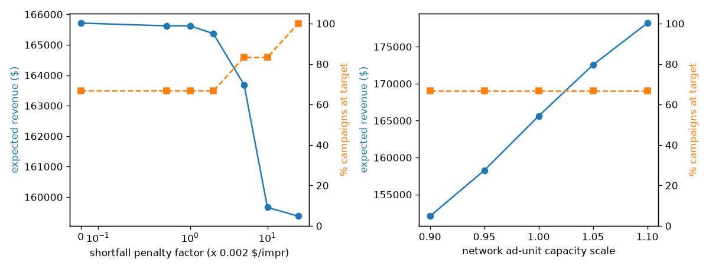

# Ad-slot allocation optimisation

[](https://github.com/SulemanQB/ad-allocation-optimisation/actions/workflows/ci.yml)

A small media / ad-yield inventory allocation demo: a mixed-integer program (MIP) that allocates ad inventory across campaigns under capacity, pacing and demand targets, solved with both Google OR-Tools (CBC) and Gurobi, and compared against greedy baselines.

Synthetic data only; not from any commercial dataset. All numbers below come from the bundled synthetic generator.

## What it models

- Slots with channel, daypart, impressions and multi-ad capacity
- Campaigns with impression targets, max CPM, priority and a pacing share cap
- Eligibility and expected CPM per slot-campaign pair
- Objective: maximise expected revenue minus a penalty (default $0.002 per impression) on unmet campaign targets

Formulation (binary `x[s,c]` = campaign `c` gets one ad unit in slot `s`; continuous `u[c]` = shortfall):

```
max  sum_{s,c} rev[s,c] * x[s,c]  -  p * sum_c u[c]
s.t. sum_c x[s,c] <= cap[s]                         (slot capacity)
     sum_s imp[s] * x[s,c] + u[c] >= target[c]      (soft target)
     sum_s imp[s] * x[s,c] <= share[c] * sum_s imp[s]   (pacing)
     0 <= u[c] <= target[c]   (hard-target variant: u[c] = 0)
```

## Methods

| Method | Description |
|--------|-------------|
| Greedy (stop at target) | Highest expected-revenue assignment first; a campaign stops buying once its target is met |
| Greedy (fair) | Same, but campaigns keep buying past target, limited only by capacity and pacing (the same limits the MIP has) |
| MIP, soft target | Formulation above, solved with OR-Tools CBC (`src/mip_ortools.py`) and Gurobi (`src/mip_gurobi.py`) |
| MIP, hard target | Same with shortfall fixed to zero, so every campaign must reach its target (may be infeasible on other instances) |

Gurobi uses the size-limited licence bundled with the pip `gurobipy` package (non-production use, up to 2000 variables / 2000 linear constraints). The seed-42 instance has 398 binary + 12 continuous variables and 64 constraints, so it fits comfortably. Larger instances need a full Gurobi licence; the CBC path has no such limit.

## Quick start

```bash
python3 -m venv .venv
source .venv/bin/activate
pip install -r requirements.txt
python -m src.run_benchmark      # writes results/benchmark.json, sensitivity.csv/png
pytest -q
```

GitHub Actions runs that install, a lightweight lint of `src` and `tests`, and `pytest` on every push and pull request. Tests use OR-Tools CBC. The Gurobi comparison is skipped when no Gurobi licence can be started (the pip licence is size-limited).

## Results (seed 42, 40 slots, 12 campaigns, 79 ad units)

From `results/benchmark.json`:

| Method | Expected revenue | Campaigns at target | Unsold ad units | Status / wall time |
|--------|-----------------:|--------------------:|----------------:|--------------------|
| Greedy (stop at target) | 89,164.09 | 12 / 12 (100%) | 44 / 79 (55.7%) | - |
| Greedy (fair) | 159,497.86 | 8 / 12 (66.7%) | 0 | - |
| MIP soft target, CBC | 165,623.57 | 8 / 12 (66.7%) | 0 | OPTIMAL / ~0.45 s |
| MIP soft target, Gurobi | 165,623.57 | 8 / 12 (66.7%) | 0 | OPTIMAL / ~0.11 s |
| MIP hard target, CBC | 159,370.62 | 12 / 12 (100%) | 0 | OPTIMAL / ~1.2 s |
| MIP hard target, Gurobi | 159,370.62 | 12 / 12 (100%) | 0 | OPTIMAL / ~0.10 s |

CBC and Gurobi reach the same objective (164,248.28 soft, 159,370.62 hard) and the same allocation revenue; Gurobi is roughly 4-12x faster here, though at this size both are well under two seconds and timings vary between runs and machines.

How to read this honestly:

- The earlier headline (MIP +85.75% vs greedy) came mostly from the greedy baseline stopping once campaigns hit target, which left 56% of inventory unsold. Against the fair greedy that can also sell remaining inventory, the soft-target MIP gains **+3.8%** revenue (165,623.57 vs 159,497.86) at the same 8/12 campaigns on target.
- The more useful comparison is the hard-target MIP: it delivers **all 12 campaigns to target** for about the same revenue as the fair greedy (159,370.62 vs 159,497.86, -0.1%). The optimiser's value here is meeting every commitment without giving up revenue, not a large revenue uplift.
- An earlier version of the greedy checked pacing before adding an assignment, so it could overshoot a campaign's pacing cap. It now applies the same pacing rule as the MIP; this did not change the stop-at-target greedy's numbers on seed 42.
- One synthetic instance; not a real-world or production revenue result. Capacity can exceed one ad per slot, so assigned impressions can exceed unique slot impressions.

## Sensitivity analysis

`python -m src.sensitivity` (also run by the benchmark) re-solves the soft-target CBC MIP while varying one input at a time. Full table in `results/sensitivity.csv`, plot in `results/sensitivity.png`.



**Shortfall penalty** (base $0.002 per unmet impression):

| Penalty ($/impr) | x base | Revenue | Campaigns at target |
|-----------------:|-------:|--------:|--------------------:|
| 0 | 0 | 165,713.36 | 8 (66.7%) |
| 0.001 | 0.5 | 165,623.57 | 8 (66.7%) |
| 0.002 | 1 | 165,623.57 | 8 (66.7%) |
| 0.004 | 2 | 165,367.14 | 8 (66.7%) |
| 0.010 | 5 | 163,689.05 | 10 (83.3%) |
| 0.020 | 10 | 159,662.96 | 10 (83.3%) |
| 0.050 | 25 | 159,370.62 | 12 (100%) |

The penalty traces a revenue vs delivery trade-off curve: within ±50% of the base value the allocation barely moves; at 25x the base it reproduces the hard-target solution, giving up about 3.8% of revenue to hit every target.

**Slot capacity** (network ad units scaled ±10%; per-slot capacities are small integers, so whole units are added or removed round-robin across slots):

| Scale | Ad units | Revenue | vs base | Campaigns at target |
|------:|---------:|--------:|--------:|--------------------:|
| 0.90 | 71 | 152,067.24 | -8.2% | 8 (66.7%) |
| 0.95 | 75 | 158,274.91 | -4.4% | 8 (66.7%) |
| 1.00 | 79 | 165,623.57 | - | 8 (66.7%) |
| 1.05 | 83 | 172,554.19 | +4.2% | 8 (66.7%) |
| 1.10 | 87 | 178,199.32 | +7.6% | 8 (66.7%) |

Revenue moves roughly in proportion to capacity (slightly less than 1:1 on the way up, as added units go to lower-value pairs), while target delivery is unchanged: at the base penalty, extra inventory is sold for revenue rather than used to close target gaps. The capacity-constraint shadow value is therefore about $1,500-1,800 per ad unit on this instance.

## Layout

```
src/generate_instance.py  # synthetic slots, campaigns, rates
src/greedy.py             # greedy baselines (stop-at-target and fair)
src/mip_ortools.py        # CBC MIP (soft or hard target)
src/mip_gurobi.py         # same MIP with gurobipy
src/metrics.py            # revenue, % campaigns at target, unsold capacity
src/sensitivity.py        # penalty and capacity sweeps
src/run_benchmark.py      # writes results/
data/                     # regenerated CSVs
results/                  # benchmark.json, sensitivity.csv/png, assignment CSVs
tests/                    # capacity, solver agreement, baseline and sweep checks
```

## Limits

- Synthetic data only; no makegoods, guaranteed vs non-guaranteed split, or live sell-out curves yet.
- Gurobi results use the size-limited pip licence; no CPLEX.
- Sensitivity is one-at-a-time on a single instance, not a full scenario or stochastic analysis.
- Do not cite these figures as production results.
